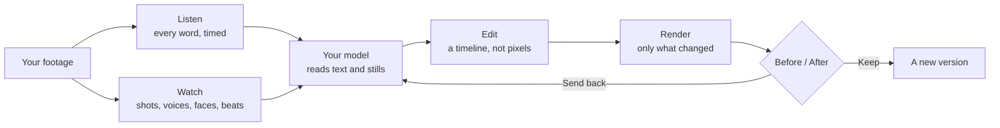
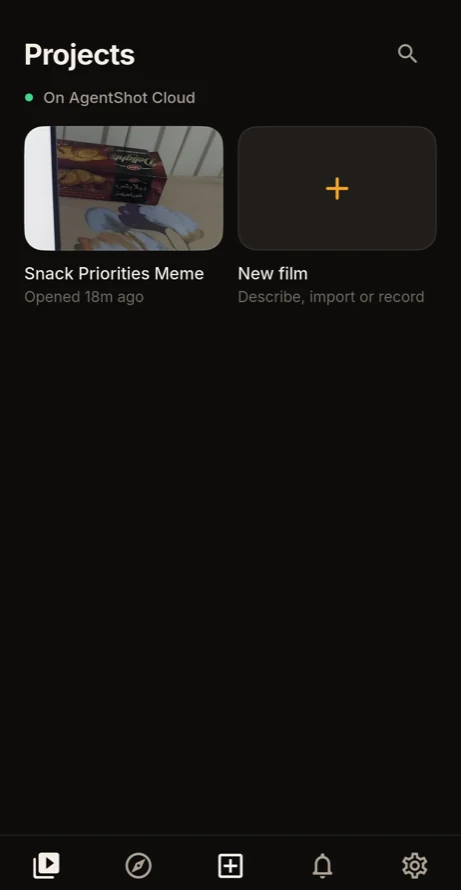
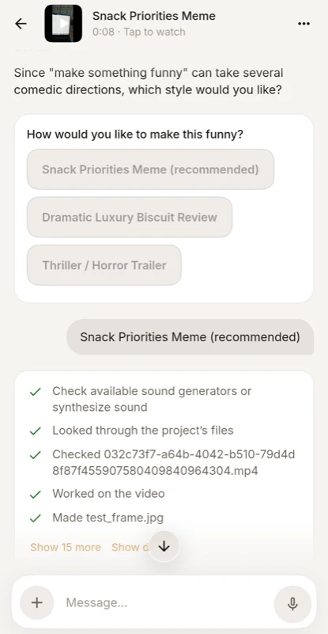
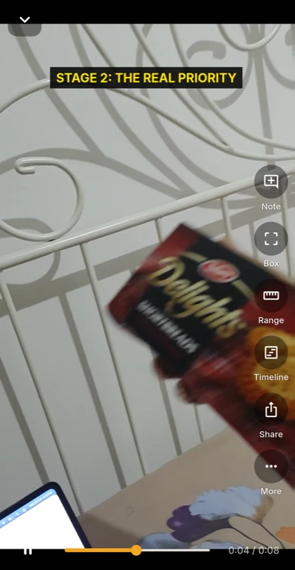
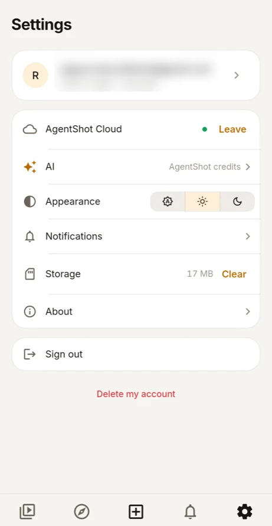

<p align="center">
  
</p>

<h1 align="center">AgentShot</h1>

<p align="center">
  <b>The video editor you talk to.</b><br>
  Say what you want. Point at the frame. Keep the cut, or send it back.
</p>

<p align="center">
  <a href="https://github.com/hormuz-labs/agentshot/releases/latest"></a>
  <a href="LICENSE"></a>
  
</p>

<p align="center">
  
</p>

```bash
brew install hormuz-labs/tap/manul
```

<p align="center"><sub>macOS. <a href="#install">Windows, Linux and the phone app below.</a> Free and open source, and your footage never leaves your computer.</sub></p>

---

Editing video is thousands of small decisions made with a mouse. AgentShot keeps the decisions and drops the mouse work: you watch your film and give notes the way a director gives them to an editor, and it makes each change **on your own computer**. Every change comes back as a new version to compare before and after. You keep it, or send it back with a reply.

https://github.com/user-attachments/assets/084276fb-6129-47e2-9cba-4724c1432990

<p align="center"><sub>90 seconds of AgentShot, starring the grumpiest cat on Earth. Footage: BBC, <i>Frozen Planet II</i>.</sub></p>

## A session

> **You:** cut the ums, and the bit where I lose my train of thought
>
> **AgentShot:** Cut 9 fillers and the restart at 0:42, each in the quiet before the next word. *2:31 → 2:12.* `Before / After` **Keep** · **Send back**
>
> **You:** *(draws a box over a parked car, 0:18–0:24)* blur this number plate
>
> **AgentShot:** Blurred that box from 0:18 to 0:24. The rest of the shot is untouched.
>
> **You:** put my name on screen when I introduce myself, and quiet music under the whole thing
>
> **AgentShot:** Lower third “Sara Malik · Product designer” at 0:04. The music loops to 2:12 and dips under every sentence.
>
> **You:** now a vertical one for Shorts, captions burned in

You point instead of describing. Press <kbd>B</kbd> and box something on the picture, drag across the timeline, or press <kbd>N</kbd> at a moment. A message box opens right there, already tied to that spot and time.

<p align="center">
  
</p>

## What happens when you say “cut the ums”

A language model can't watch video. So before it decides anything, AgentShot turns your film into things a model can read: the words, the voices, the shots, the faces, the beat. All of that is measured on your machine. The model reads the result, writes an edit, and AgentShot renders it.



1. **It listens.** whisper.cpp ships inside the app and transcribes every word with its timing. Raw Whisper word times drift by seconds over music, so AgentShot re-times each word with DTW token timestamps and cuts in the silence *between* words. That's why “drop the second take” lands on the right syllable.
2. **It watches.** One decode pass through one FFmpeg filter graph measures shots, camera shake, exposure, black and frozen frames, loudness and silence. Then it works out:
   - **who speaks when:** sherpa-onnx diarization, regrouped so a two-hour film comes out as its main voices rather than 378 fragments.
   - **where the subject is:** faces (YuNet) and objects (YOLOX), tracked shot by shot.
   - **where the beat falls:** tempo, bars and drops, from aubio.

   So *“keep only Ravi's answers”*, *“lose the shaky bits”* and *“cut on the beat after the drop”* each mean something exact.
3. **It thinks, with your model.** Claude, Gemini, GPT or any OpenAI- or Anthropic-compatible endpoint, picked per project. The model gets the transcript, the measurements and still frames it asks to look at. **Never your footage.**
4. **It edits a timeline, not your pixels.** Cuts, titles, lower thirds, captions, music and reframes are written into an edit you can still change by hand. Titles are real typography, so you can drag, resize or retype any word on the picture afterwards.
5. **It renders only what changed.** If an edit only cuts one H.264 file, the untouched stretches between keyframes are copied as they are, and only the frames around each cut are encoded again. A few cuts in a long film take seconds, not a full export.
6. **It proposes, and you decide.** Nothing is overwritten. Each project keeps its own history as a git repository inside its folder (isomorphic-git, no git install needed), so every version you ever kept is one click away.

The agent is durable: it runs on a pi-durable harness backed by SQLite, so a conversation, and the tool call it was in the middle of, survives a crash or a quit. It's also fenced in. Its shell runs inside the operating system's sandbox (Seatbelt on macOS, Landlock on Linux), and it can reach the project folder and AgentShot's own tools, but not your home folder, other projects or your keys.

## Things you can just say

| You say | What makes it work |
| --- | --- |
| “cut the ums and the false starts” | word-level transcript, cuts placed in the silence between words |
| “keep only Ravi's answers” | diarization: who speaks when, each voice named once |
| “blur this” *(with a box)* | the box and the time range travel with the note |
| “make a 9:16 for Reels” | a crop path that follows the face or subject, shot by shot |
| “cut to the beat after the drop” | beat grid, bars and energy curve of the track |
| “name on screen when she introduces herself” | lower thirds designed as HTML/CSS, timed to the words |
| “music under it, quieter when I talk” | the mix ducks under speech, and you hear it live before anything renders |
| “sync the second camera” | audio cross-correlation (GCC-PHAT) with clock-drift fitting |
| “captions are always yellow” | memory: said once, every later project knows |
| “put @logo.png bottom right” | <kbd>@</kbd> picks any file, kept version or title by name |

It also knows how different films are cut: talking heads, tutorials, Shorts and Reels, promos, montages, motion graphics, cleanup and repair. These skills are plain files you can read and change.

## No footage? Two other ways in

**Start from an example.** Under the message box are **233 motion videos** people made with Claude, each with the prompt behind it (collected by [prompt-motion.com](https://prompt-motion.com)). Pick one, say what yours is about, and AgentShot makes yours the same way. It studies the video, asks for what it needs (your words, logo, a track) and shows a storyboard before it makes a frame. The scenes are real motion graphics, so a note like “the title lands late” changes one scene, not the whole film.

<p align="center">
  
</p>

**Have your product filmed.** Say *“a walkthrough of app.example.com: sign up and make a first project”*. AgentShot first tries the product without filming, then shows a storyboard: one line per step, with what it will do and what the voice will say. Say **film it**, and it films the whole thing in one take in your own Chrome, where you're already signed in. Then it edits it like a person would:

- the time it spent thinking is cut, and slow loads are sped through
- each step holds until its line is said
- it zooms in on what's being done, with a cursor gliding into each click

Notes like “tighter” or “say step 3 differently” don't film anything again.

<sub>Filming goes through <a href="https://github.com/Tencent/BrowserSkill">BrowserSkill</a>, with no setup. Turn on Chrome's remote debugging for up to 60 frames a second instead of about 10. The agent's overlay never shows on film, and filming pauses while you sign in.</sub>

## On your phone

<table>
<tr>
<td width="25%"></td>
<td width="25%"></td>
<td width="25%"></td>
<td width="25%"></td>
</tr>
</table>

The phone app doesn't edit anything itself. It's a remote for the editor on your computer, built for one hand:

- **Notes, typed or spoken.** Mark a moment, box the picture or note a range, then say what should change. The mic uses the phone's own speech recognition.
- **New cuts open where you are.** A new cut opens in the conversation with Before / After, **Keep** and **Send back** at thumb height.
- **It opens instantly, even offline.** Projects, conversations and films are kept on the phone. Only what changed on the computer comes over the network again (ETags all the way down), and anything kept still plays with no signal.
- **Your computer can be off.** With your computer off, the phone works on **AgentShot Cloud**, in a space of your own that's kept between visits. You can also lend a spare computer or a server to the pool: see [cloud workers](docs/cloud-workers.md).

**How it reaches your computer from anywhere.** Your computer and your phone both join a private network that AgentShot builds into each app: a userspace WireGuard node (tsnet) talking to AgentShot's Headscale server. There's no Tailscale to install, no IP address to type and no port to forward. The phone pins your computer's TLS certificate, so the connection is encrypted end to end even inside that network. On the same Wi-Fi it goes direct, which takes about a second.

<sub>Sign in with the same account on both and every computer of yours is listed, or pair with a QR code. Reaching your computer away from home and AgentShot Cloud are on Android for now; an iPhone connects on the same Wi-Fi. The app is in Google Play testing: until it's public, build it from <a href="mobile/README.md"><code>mobile/</code></a>.</sub>

## Your footage stays yours

- **Editing, transcription and analysis run on your computer.** There's no upload queue and no cloud project.
- **The AI model sees text and still frames.** It never sees the video file.
- **Your keys stay in your system's keychain.** The agent's sandbox can't read them.
- **Crash reports and usage statistics are off until you tick them.** They never include footage, file or project names, prompts, transcripts or keys. See [exactly what is sent](telemetry/README.md).
- **The agent browses in its own browser, never yours.** It only uses your Chrome if you switch that on, or to film a walkthrough where you're signed in.

## Install

| Platform | |
| --- | --- |
| **macOS** (Apple silicon and Intel) | `brew install hormuz-labs/tap/manul`, signed and notarized |
| **Windows 10 (1903+) / 11, x64** | [`AgentShot-windows-x64-Setup.exe`](https://github.com/hormuz-labs/agentshot/releases/latest) |
| **Debian / Ubuntu** | the signed apt repository, [below](#debian--ubuntu) |
| **Other Linux** | AppImage from the [latest release](https://github.com/hormuz-labs/agentshot/releases/latest) |
| **Android** | build from [`mobile/`](mobile/README.md) until the Play Store listing is public |

<details>
<summary><b>macOS, if you've never used Terminal</b></summary>
<br>

Press <kbd>⌘</kbd> <kbd>Space</kbd>, type **Terminal**, press <kbd>↵</kbd>, paste this and press <kbd>↵</kbd>:

```bash
brew install hormuz-labs/tap/manul
```

If it says `brew: command not found`, install [Homebrew](https://brew.sh) first, then paste the line again.

</details>

<details>
<summary><b>Windows</b></summary>
<br>

Download `AgentShot-windows-x64-Setup.exe` from the [latest release](https://github.com/hormuz-labs/agentshot/releases/latest) and run it. It's a single offline installer: no wizard, and no Node, Python, FFmpeg or developer tools needed. It installs for your account, opens AgentShot, and updates itself from then on. The installer is signed with Hormuz Labs' own certificate, so SmartScreen may ask once: **More info → Run anyway**.

</details>

<a name="debian--ubuntu"></a>
<details>
<summary><b>Debian / Ubuntu</b></summary>
<br>

```bash
curl -fsSL https://apt.agentshot.si/manul.gpg | sudo gpg --batch --yes --dearmor -o /usr/share/keyrings/manul.gpg &&
echo "deb [signed-by=/usr/share/keyrings/manul.gpg] https://apt.agentshot.si stable main" | sudo tee /etc/apt/sources.list.d/manul.list &&
sudo apt update && sudo apt install manul
```

</details>

<details>
<summary><b>Let your coding agent install it</b></summary>
<br>

```text
Install AgentShot from https://github.com/hormuz-labs/agentshot. On macOS run `brew install hormuz-labs/tap/manul`. On Windows, download `AgentShot-windows-x64-Setup.exe` from https://github.com/hormuz-labs/agentshot/releases/latest and run it. On Debian or Ubuntu, add the apt repository at https://apt.agentshot.si and run `sudo apt install manul`; on other Linux, download the AppImage for this machine's architecture from the latest release. Then open AgentShot.
```

</details>

**First run.** Sign in under **Settings → Keys** to use AgentShot's credits, or bring your own Claude, Gemini or OpenAI key (your own keys are used first). A short guided start takes you from a key to your first note. You can replay it any time from <kbd>⌘K</kbd> / <kbd>Ctrl+K</kbd>.

## What's in this repository

| | |
| --- | --- |
| [`src/`](src) | the desktop app: Electron and React, the agent and its tools (`src/main/agent.ts`), the media pipeline |
| [`mobile/`](mobile/README.md) | the phone app, in Flutter, with the private-network node built in |
| [`scripts/`](scripts) | builds of the native helpers: `agentshot-mesh` (tsnet), `-speakers` (sherpa-onnx), `-vision` (YuNet, YOLOX), `-beats` (aubio), `-fence` (Landlock), whisper.cpp, FFmpeg |
| [`account/`](account/README.md) | the account service: sign-in, credits, your computers, the private network's keys |
| [`gateway/`](gateway/README.md) | the AI gateway behind AgentShot's credits |
| [`site/`](site/README.md) | [agentshot.si](https://agentshot.si) |

Renders use your graphics chip when they can: Apple's on a Mac, NVIDIA, Intel or AMD on Windows, NVIDIA on Linux. Everything else falls back to the CPU. **Got a GPU we don't cover?** [Adding one is a small change](CONTRIBUTING.md#gpu-encoders), and we'd love the help.

To run it from source, see **[CONTRIBUTING.md](CONTRIBUTING.md)**. For how the services are hosted, see [workspace and hosting](docs/workspace.md). For what's next (handing the cut to Premiere, Resolve or Final Cut, publishing to YouTube, notes from clients on the frame), see the **[roadmap](ROADMAP.md)**.

---

<p align="center">
  <br>
  <sub>The cat is a <b>manul</b>, a Pallas's cat: small, patient, and unbothered by anything. It sits beside your message box, follows your cursor, and waves when an edit is done.</sub><br><br>
  <sub>Free and open source under the <a href="LICENSE">GNU GPL v3 or later</a> · <a href="THIRD_PARTY_NOTICES.md">Third-party notices</a> · Made by <a href="https://github.com/hormuz-labs">Hormuz Labs</a></sub><br>
  <sub>If you like where it's going, a ⭐ helps other people find it.</sub>
</p>
