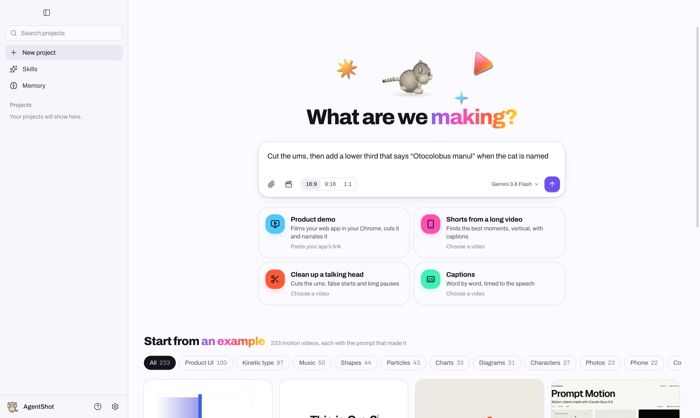
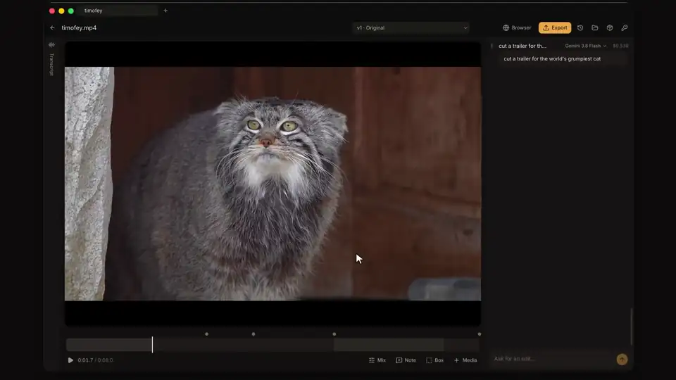
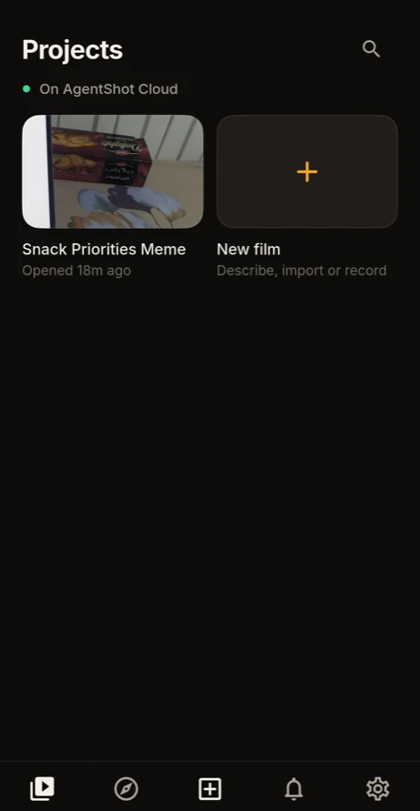
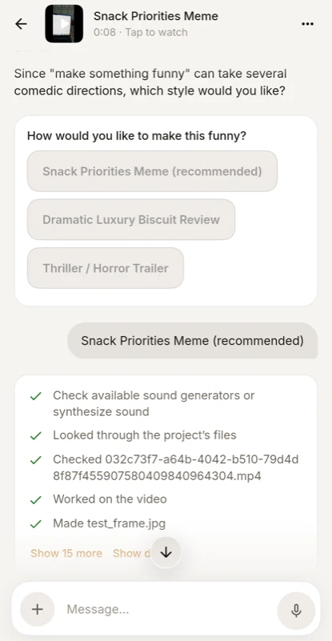
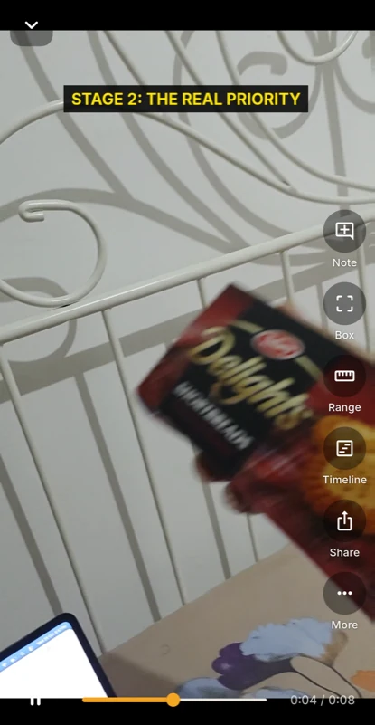
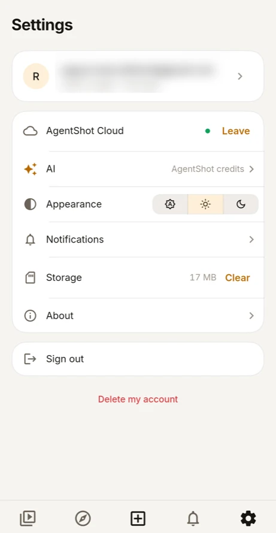

# AgentShot user manual

AgentShot is a video editor you direct in plain words. You say what should change, or point at the moment or the part of the picture, and AgentShot makes the edit on your computer. Every edit comes back as a proposal. You keep it or reject it, and every version stays in the project.

This manual covers the desktop app (macOS, Windows and Linux) and the phone app that works as its remote.

- [1. Install and first run](#1-install-and-first-run)
- [2. Start a project](#2-start-a-project)
- [3. Working with the agent](#3-working-with-the-agent)
- [4. Your files and footage](#4-your-files-and-footage)
- [5. The timeline and manual edits](#5-the-timeline-and-manual-edits)
- [6. Export](#6-export)
- [7. On your phone](#7-on-your-phone)
- [8. Settings reference](#8-settings-reference)
- [9. Keyboard shortcuts](#9-keyboard-shortcuts)
- [10. When something goes wrong](#10-when-something-goes-wrong)

## 1. Install and first run

### Install

Download AgentShot from the [latest release](https://github.com/hormuz-labs/agentshot/releases/latest):

- **macOS:** the Apple silicon or Intel `.dmg`, or `brew install hormuz-labs/tap/manul`.
- **Windows 10 (1903 or later) or 11:** `AgentShot-windows-x64-Setup.exe`. It installs for your account and updates itself. If SmartScreen asks, choose **More info**, then **Run anyway**.
- **Debian or Ubuntu:** the apt repository described in the [README](../README.md#install).
- **Other Linux:** the AppImage.

### The first questions

In builds that can report, AgentShot asks once whether to send crash reports and usage statistics. Both start unticked. Closing the box counts as no. You can change this later in **Settings → About**.

### Set up an AI

AgentShot needs an AI model to plan edits. Editing, transcription and analysis run on your computer either way. The model reads text and a few still frames, never your video file.

Open **Settings → Keys**. Until a key is set, the start screen shows **Add an API key so AgentShot can edit (Gemini, Anthropic or OpenAI)**, and the chat shows **Add an API key to start editing**. Both open the same place.

You have two ways to set it up. They are the two tabs in **Settings → Keys**.

**AgentShot key** (credits). Click **Sign in to AgentShot** and finish signing in in your browser. AgentShot picks the model for each job. New accounts start with 1,000 credits. Pro and Max plans add credits every month and unlock the Max and Ultra models. Once you are signed in, the tab shows your credits, your plan, and buttons to buy a plan, buy more credits or **Manage billing**. If someone gave you a key instead, click **Have a key? Paste it**.

**Your own keys.** Click **Add** next to a provider and paste the key. Keys are stored encrypted in your system keychain. Your own keys are used before AgentShot credits.

| Provider | What it unlocks | Where to get a key |
| --- | --- | --- |
| Google Gemini | editing agent, image generation, AI voice, music | aistudio.google.com → Get API key |
| Anthropic | editing agent | console.anthropic.com → API keys |
| OpenAI | editing agent, image generation, AI voice | platform.openai.com → API keys |
| ElevenLabs | AI voice, music | elevenlabs.io → Profile → API keys |

The box **What works with your keys** at the bottom of the tab shows which features your keys cover.

Under **Other providers** you can add any OpenAI- or Anthropic-compatible endpoint, such as Azure AI Foundry, a company gateway or a local server. Click **Add**, then give it a name, the API type, a base URL, the model ids and the key. Its models then appear in the model picker.

### Guided tours

The first time, a short tour shows you around the start screen, and another shows you around the editor when your first project opens. You can replay it any time: click the tour button at the bottom of the sidebar, choose **Help → Product Tour**, or search "tour" in the command palette (<kbd>⌘K</kbd> on a Mac, <kbd>Ctrl+K</kbd> elsewhere).

## 2. Start a project

The start screen asks **What are we making?** It has one message box. What you put in the box decides what kind of project you get:

- **Footage to edit.** Drop files anywhere on the screen, or click the paperclip (**Choose files**). Include at least one video. MP4, MOV, WebM and MKV all work, and so do other common video formats. Photos, audio, subtitles, fonts, folders and zip files can come along. Click **Add more files** to add more, or the × beside a file to drop it.
- **A motion video from nothing.** Leave out footage and describe what you want. A **16:9 / 9:16 / 1:1** switch appears so you can pick the shape.
- **A product walkthrough.** Describe a walkthrough of a website, with its link. AgentShot says it will try the product in its browser, show you the plan, then film it and narrate it.

Type what you want done (or leave it blank), then click the arrow or press <kbd>Enter</kbd>. AgentShot creates the project and sends your words as the first message.

The model dropdown in the box sets the model for the new project. Leave it as it is to use the default.

### One-click jobs

Under the box are four common jobs. Each one sends a ready-made first message.

| Job | What it does |
| --- | --- |
| **Product demo** | Films your web app in your Chrome, cuts it and narrates it. It fills in the start of the sentence; paste your app's link and press <kbd>Enter</kbd>. |
| **Shorts from a long video** | Finds the 3 best moments and makes each a vertical Short with word-by-word captions. |
| **Clean up a talking head** | Cuts the ums, false starts and long pauses, and evens out the sound. |
| **Captions** | Adds word-by-word captions timed to the speech. |

The video jobs use the video already in the box. If there isn't one, they ask you to choose one.

### Start from an example

Below the jobs is a gallery of motion videos, each with the prompt that made it. Filter by tag, then click **Use this example**. The example appears in the message box. Say what your video is about, and AgentShot makes yours the same way. It tells you up front what it will ask you for, such as your words, a logo or a track.

To copy the look of a video you already have, click the clapperboard button (**Match the look of a video**) and choose it. AgentShot takes the look, not the content.

### Product walkthroughs

For a walkthrough, AgentShot first tries your product without filming, then shows a storyboard: one line per step, with what it will do and what the voice will say. When you say to film it, it films in one take in Chrome, then cuts it: thinking time is removed, slow loads are sped up, and it zooms in on what's being done.

## 3. Working with the agent

When a project opens, the chat is on the left and the film is on the right. The sidebar on the far left lists your projects. Each open project expands into **Chats** and **Files**.

### Chat

Type in the message box and press <kbd>Enter</kbd> to send. <kbd>Shift+Enter</kbd> adds a new line. Say it the way you'd say it to an editor: "trim this to the best 30 seconds and add my name at the start".

- **Keep talking while it works.** While AgentShot is busy, the box says **Steer the edit…**. A message you send then is queued, and AgentShot reads it next.
- **Questions.** When AgentShot needs a choice from you, it shows the options as buttons. **You decide** lets it use its own recommendations.
- **Requests for permission.** Before a download or install, a card asks you. Click its button to allow it, or **Not now**.
- **Voice notes.** The microphone button records a spoken note: hold it to talk, or click it to talk hands-free. Click the tick (or press <kbd>Enter</kbd>) when done, or × (<kbd>Esc</kbd>) to throw it away. What you said is typed into the box.
- **Model.** The model picker in the message box sets the model for this project.
- **Cost.** When you use your own keys, the amount spent on AI in this project shows next to the model picker.
- **Work details.** Each step AgentShot takes is listed in the conversation. **Show details** opens the technical detail.

### Several chats

A project can have several conversations. Start one with **New chat** (<kbd>⌘⇧N</kbd> / <kbd>Ctrl+Shift+N</kbd>), the **+** next to **Chats** in the sidebar, or the chat title at the top of the window, which also lists, switches and renames chats.

### Attaching files and @ mentions

- Click **+** (**Add files**) in the message box to bring new files into the project.
- Click a file under **Files** in the sidebar to attach it to your next message. Click again to take it off. A folder's paperclip attaches all its files.
- Type <kbd>@</kbd> in the message box to pick a file, version or clip by name. Use the arrow keys and <kbd>Enter</kbd> or <kbd>Tab</kbd> to choose. For example: "put @logo.png bottom right".

### Pointing: Note, Box and ranges

You can point at what you mean instead of describing it. The note carries the exact time, range or area.

- **Note** (<kbd>N</kbd>): marks the moment under the playhead. A message box opens right there.
- **Box** (<kbd>B</kbd>): pauses the film. Draw a box around part of the picture, then say what to do with it, like "blur this number plate".
- **Range:** drag across the timeline. The range is added to your message, so you can describe several ranges in one message.

Notes show as marks on the timeline. Hover one to see what you asked and the reply.

### Stopping

Click the square **Stop** button in the message box, choose **Agent → Stop**, or press <kbd>⌘.</kbd> / <kbd>Ctrl+.</kbd>.

### Proposals: Accept or Reject

When AgentShot finishes an edit, a **Proposed:** bar appears above the film with a short title.

1. Switch between **Before** and **After**, and play or scrub both.
2. Click **Accept** to keep it as a new version.
3. Or click **Reject** to discard it, and tell AgentShot in the chat what to try instead.

Nothing is overwritten. Your original stays a separate version.

### Versions and history

- **Versions:** the version picker at the top of the window, next to the project name, switches between versions you kept.
- **History** (<kbd>⌘⇧H</kbd> / <kbd>Ctrl+Shift+H</kbd>, or **View → History**) lists every proposal, decision, manual edit and note, newest first. Hover an entry and click **Restore** to go back to that point.

### Memory and skills

Say "remember that…" (for example, "remember that captions are always yellow") and AgentShot keeps it in **Settings → Memory** for every later project. Skills say how each kind of video is made. See [Settings reference](#8-settings-reference).

### AgentShot's browser

When the agent needs the web (research, references, footage or music), it uses its own browser. Open it with the globe button at the top of the project, **View → Browser**, or <kbd>⌘⇧B</kbd> / <kbd>Ctrl+Shift+B</kbd>. Sign in there only to sites you want the agent to use.

## 4. Your files and footage

### Adding files

- Drop files anywhere in the project window.
- **File → Add Files…** (<kbd>⌘I</kbd> / <kbd>Ctrl+I</kbd>).
- The **+** next to **Files** in the sidebar, or **Add files** in the Files panel.

### The Files panel

Click the **Files** button (the picture icon) at the top of the project to open everything you brought in, over the film. Filter by **All**, **Videos**, **Photos**, **Sound** or **Other**. Each file has a short summary of what's in it.

- Click a file to open it large. Videos and sound play, and arrows step to the previous or next file.
- **Attach to message** attaches it to your next message.
- **Film** (or **Put in the film**) puts a video into the film at the playhead. You can also drag footage from the sidebar onto the timeline.

In the sidebar's file list, each file also has buttons to download it and to show it in Finder or your file manager. Files you added can be deleted there; they move to the Trash. A file the film still uses can't be deleted.

### Preview copies for heavy footage

Some footage is hard to play smoothly: anything larger than 1080p, 10-bit or 4:2:2 video, codecs other than H.264, VP8, VP9 and AV1, and very high bitrates. For these, AgentShot makes a light 720p preview copy in the background. You'll see **Making a preview copy for smooth playback…** with a percentage.

The preview copy is only for playback. Renders and exports always use your original footage, at full quality.

If the copy fails, you'll see **Preview copy failed. Playing the original where supported.** Click **Retry preview** to try again.

## 5. The timeline and manual edits

You don't need the timeline, but it's there when you want to do something by hand.

### Playing and moving around

- Click Play, or press <kbd>Space</kbd>, to play and pause.
- Click the timeline to jump to that moment.
- <kbd>←</kbd> and <kbd>→</kbd> move one second. Hold <kbd>Shift</kbd> to move five.
- Pinch, or hold <kbd>⌘</kbd> / <kbd>Ctrl</kbd> and scroll, to zoom the timeline. The **Fit timeline** button shows the whole film again.

These single keys work only when you're not typing in a box.

### Edits you can make yourself

The buttons under the timeline:

- **Move clip:** turn it on, then drag a clip to a new place. Click it again or press <kbd>Esc</kbd> to stop.
- **Split:** splits the selected clip at the playhead.
- **Voiceover** (Pro): records your own voice over the film. You can pause, resume, then **Stop & add to video**. The voiceover gets its own track under the timeline, where you can trim it, move it and change its volume.

Right-click a piece on the timeline for its actions: **Split at playhead**, **Remove clip**, move it before another clip, and **Edit motion** for a motion clip.

**Motion clips and titles.** Click a motion clip on the timeline to open it on the picture. Its parts are outlined. Drag a part to move it, or click it to ask the agent about just that part. Press <kbd>Esc</kbd> when done.

**Video placement.** When a video piece is selected, **Video placement** lets you fit or fill the frame, scale it and offset it. **Reset placement** puts it back.

### Saving your hand edits

A hand edit plays straight from its pieces. The timeline shows **Edited** with a **Save as version** button. Click it (or choose **Edit → Save as Version**) to render it as a version. Export renders it too.

<kbd>⌘Z</kbd> / <kbd>Ctrl+Z</kbd> undoes a timeline edit, and <kbd>⌘⇧Z</kbd> / <kbd>Ctrl+Shift+Z</kbd> redoes it. If you switch version with unsaved hand edits, AgentShot asks first. History keeps them either way.

## 6. Export

Click **Export** at the top right, choose **File → Export…**, or press <kbd>⌘E</kbd> / <kbd>Ctrl+E</kbd>. You get a finished MP4 of the version on screen.

**Size:**

| Choice | Size | For |
| --- | --- | --- |
| **Original** | same as the film | |
| **16:9 · 1080p** | 1920 × 1080 | YouTube, websites |
| **9:16 · 1080×1920** | 1080 × 1920 | Shorts, Reels, TikTok |
| **1:1 · 1080×1080** | 1080 × 1080 | feeds |

When the shape is different from the film, choose **Blurred fill** (the film sits on a blurred copy of itself) or **Crop to fill**.

**Captions (from the transcript):** **None**, **In the picture** or **Separate .srt**. If your film already has captions in it, choose **None** so you don't get two sets. For corrected wording or styled captions, ask in the chat instead. For more accurate export captions, you can click **Download Whisper Large-v3 · 3.1 GB**. It runs on your computer and is used automatically once installed.

Click **Export** and choose where to save. Progress shows in the jobs tray. When it's done, click **Show** to find the file.

### Finish it in another editor

**Export for another editor** saves the cut for Premiere Pro, DaVinci Resolve or Final Cut Pro, together with the footage it uses. Every cut can still be trimmed. Motion graphics and titles go over as video files. Open the `.fcpxml` in Final Cut or Resolve, or the Premiere `.xml` in Premiere. The folder includes a `How to open.txt`.

### Do more to it in the cloud

When AgentShot's cloud machines offer work your computer can't do well (such as upscaling or isolating the voice), the export dialog shows **Do more to it in the cloud**. You need to be signed in under **Settings → Keys**. Each job shows its price in credits. Click **Run**, read the price, then confirm. Only this film is sent. The result comes back as a new version to accept or reject, and the jobs tray shows its progress.

## 7. On your phone

The AgentShot phone app is a remote for the editor on your computer. The phone doesn't edit anything itself. It sends footage, gives notes and reviews the film. The app is in Google Play testing; until it's public, build it from [`mobile/`](../mobile/README.md).

<table>
<tr>
<td width="25%"></td>
<td width="25%"></td>
<td width="25%"></td>
<td width="25%"></td>
</tr>
</table>

### Connect your phone

**With your Google account** (works at home and away):

1. On your computer, open **Settings → Mobile**, click **Sign in**, and sign in.
2. Make sure **Let my phones connect** is on.
3. On your phone, tap **Continue with Google** with the same account. Your computers show up by themselves.

**With a code** (no account, same Wi-Fi):

1. On your computer, open **Settings → Mobile → Connect without an account** and click **Show a pairing code**.
2. A QR code and a 6-digit code appear, with a countdown until they expire.
3. On your phone, tap **Other ways to connect**, then **Scan QR code**, or type the 6 digits (or **Paste code**). You can also scan the QR code with the phone's camera.

Use **New code** for a fresh code, or **Copy pairing link** to send the link to your phone another way. A computer can have up to 10 phones paired with a code.

Reaching your computer away from home is on Android for now. An iPhone connects on the same Wi-Fi.

### What the phone can do

The phone has four tabs: **Projects**, **Examples**, **Activity** and **Settings**.

- **Start something new.** Tap **+** and choose **Describe it**, **Import** (videos and photos from the phone), **Record** or **Walkthrough**. Or pick an example and tap **Use this example**.
- **The conversation.** A project opens on its conversation, with the film as a strip on top. Type a note, or tap the mic and speak (it uses the phone's own speech recognition). You can attach files and @ mention a file, version or clip.
- **The film.** Tap the strip to watch the film full screen. Use **Note**, **Box** and **Range** to point at a moment, part of the picture or a stretch of time, then type what should change. Several notes can wait together and go with one **Send**.
- **New cuts.** A new cut opens with **Before** / **After**, **Keep** and **Send back**.
- **Project actions** (the ⋯ menu): **Export film**, **Files**, **Conversations**, **Choose model**, **History**, **Transcript**, **Timeline & mix** and **Versions**. **Export film** renders on your computer, then downloads the film to the phone and opens the share sheet.
- **Activity** lists renders, exports and anything that needs your OK.
- **Offline.** Projects, conversations and films you've played are kept on the phone, so they open even without a signal.

### AgentShot Cloud

When signed in, your phone can also work on **AgentShot Cloud** instead of a computer, in a space of your own. This is on Android for now. **Leave** in the phone's Settings stops using it. Your projects stay in your space.

### Notifications

The phone can notify you when:

- the agent is done or asks something (its reply, or a new cut to look at),
- AgentShot needs your OK (a download or install it asks about),
- a render or export finishes, or doesn't.

Tap a notification to open its project. Turn each kind on or off in the phone's **Settings → Notifications**. All are on at first.

### Paired phones on your computer

In **Settings → Mobile** on your computer:

- Phones signed in with your account are listed under **Let my phones connect**, by name, with when they were last connected.
- Phones paired with a code are listed under **Paired with a code**. Each shows the phone's model (for example, "Samsung Galaxy S23" or "iPhone 16 Pro") and whether it's **Connected now** or when it was last connected, such as "Last connected 5 minutes ago".
- Click **Remove** next to a phone to unpair it. It has to pair again with a new code.
- To stop all signed-in phones reaching this computer, turn off **Let my phones connect**.

If the same phone pairs again, it replaces its old entry instead of appearing twice.

### Disconnecting from the phone

In the phone's **Settings**, the row with your computer's name has a button at its end:

- **Disconnect** (paired with a code): the phone forgets the computer and asks the computer to forget it too. If the computer can't be reached, the phone stays listed there until you remove it on the computer. The films saved on the phone for that computer are cleared.
- **Switch** (signed in): choose another of your computers.
- **Leave** (on AgentShot Cloud): stop using the cloud space.

### Phone settings

- **Appearance:** as the phone, light or dark.
- **Notifications:** see above.
- **On *your computer*:** **Skills & profiles**, **Memory**, **Desktop tools**, **Agent browser** and **Model providers**. These change the settings on the computer the phone is connected to.
- **Storage:** **Clear** removes saved films from the phone. They stay on your computer.
- **Sign out** and **Delete my account**.

## 8. Settings reference

Open Settings with the gear at the bottom of the sidebar, or <kbd>⌘,</kbd> / <kbd>Ctrl+,</kbd>.

| Section | What it's for |
| --- | --- |
| **Appearance** | **Light**, **Dark** or **Match system**. The film always plays on black. |
| **Keys** | **Your own keys** (Gemini, Anthropic, OpenAI, ElevenLabs, and **Other providers**) and the **AgentShot key** (sign in, credits, plans). See [Set up an AI](#set-up-an-ai). |
| **Skills** | How AgentShot does each kind of work. **Built in** skills come with the app. Under **Yours**, click **New skill** to tell AgentShot once how you like your videos made. Each skill has a **Name**, **When to use it** and **What to do**. Choose a **Profile**, or make a **New profile**, to keep different sets of skills. |
| **Memory** | What AgentShot has learned about your taste and rules. It uses them in every project. Add, edit or delete any of them. |
| **Browser** | Where the agent goes on the web. **AgentShot's own browser (recommended)** is separate from your personal browsers. **Your Chrome** lets the agent use your Chrome, with your sign-ins, through the BrowserSkill extension. It asks before posting, buying or uploading. |
| **Tools** | AgentShot ships with FFmpeg and whisper.cpp. Heavier tools download only when needed. **Install** or **Remove** them here. **Speech recognition** lets you choose another program or model, or **Detect again**. |
| **Mobile** | Connecting phones, paired phones, and **Cloud & home workers**: hand rendering and agent edits to a cloud worker or another of your computers, or **Share this computer as a cloud worker**. |
| **About** | Version, updates (**Check now**, **Restart to update**), **Send crash reports** and **Share usage statistics** (both off unless you tick them), and **Open-source licences**. |

## 9. Keyboard shortcuts

On a Mac, use <kbd>⌘</kbd>. On Windows and Linux, use <kbd>Ctrl</kbd>. The command palette (<kbd>⌘K</kbd> / <kbd>Ctrl+K</kbd>) shows every command with its shortcut.

| Action | Mac | Windows and Linux |
| --- | --- | --- |
| Command palette | ⌘K | Ctrl+K |
| New project (start screen) | ⌘N | Ctrl+N |
| Add files | ⌘I | Ctrl+I |
| Export | ⌘E | Ctrl+E |
| Close project | ⌘W | Ctrl+W |
| Next project | ⌃Tab | Ctrl+Tab |
| Previous project | ⌃⇧Tab | Ctrl+Shift+Tab |
| Go to project 1–9 | ⌘1 … ⌘9 | Ctrl+1 … Ctrl+9 |
| Settings | ⌘, | Ctrl+, |
| Show or hide the sidebar | ⌘\ | Ctrl+\ |
| History | ⇧⌘H | Ctrl+Shift+H |
| Browser | ⇧⌘B | Ctrl+Shift+B |
| New chat | ⇧⌘N | Ctrl+Shift+N |
| Ask AgentShot (focus the message box) | ⌘L | Ctrl+L |
| Stop the agent | ⌘. | Ctrl+. |
| Undo a timeline edit | ⌘Z | Ctrl+Z |
| Redo a timeline edit | ⇧⌘Z | Ctrl+Shift+Z |

In a project, when you're not typing in a box:

| Key | Action |
| --- | --- |
| <kbd>Space</kbd> | Play or pause |
| <kbd>N</kbd> | Note at the playhead |
| <kbd>B</kbd> | Draw a box on the picture |
| <kbd>←</kbd> / <kbd>→</kbd> | Back or forward one second (with <kbd>Shift</kbd>, five seconds) |
| <kbd>Esc</kbd> | Cancel the note, box or clip you're on |

In the message box, <kbd>Enter</kbd> sends, <kbd>Shift+Enter</kbd> adds a new line, and <kbd>Esc</kbd> leaves the box.

## 10. When something goes wrong

### The red box

When something doesn't work, such as a file that can't be added, or the agent or its browser not starting, a red box appears in the middle of the window. It says what happened and what to do next, in plain words. For a file that couldn't be added, **Choose another file…** lets you pick a different one. **Dismiss** or × closes it.

If an edit fails partway, the conversation shows the problem in plain words. **Show details** reveals the technical message, which is useful if you report it.

Common causes and what to do:

- **The AI service turned down the key:** check the key in **Settings → Keys**.
- **The AI account is out of credit:** top up, or use another key.
- **The AI service is busy:** wait a minute, then try again.
- **The file can't be read:** it may be damaged, still downloading, or in an unusual format. Try exporting it again as MP4.
- **The disk is full:** free up some space, then try again.

### The jobs tray

Long tasks (exports, preview copies, tool downloads, cloud jobs) show in the jobs tray at the top right of the window. It stays hidden until something runs. Click it to see each job with its progress. A job that failed shows a warning sign and the reason.

### Where your projects live

Each project is a folder in a **Manul** folder inside your system's Videos folder (on a Mac, **Movies**). To open the current one, choose **File → Show Project in Finder** (or **Show Project Folder** on Windows and Linux), or click the folder button at the top of the project. A project's history is kept inside its folder.

To remove a project, hover it in the sidebar and use its delete button. It moves to the Trash.

### Getting help

- **Help → User Guide** opens this guide.
- **Help → Report a Problem** opens a new issue on GitHub. Say what you did, what you expected, and paste any details from the red box or **Show details**.
- **Help → Product Tour** replays the guided tour.
- Email [support@agentshot.si](mailto:support@agentshot.si).
